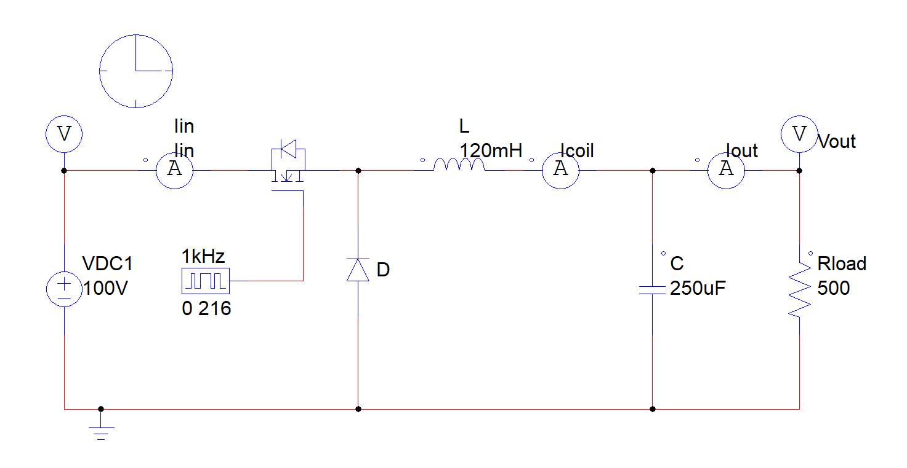
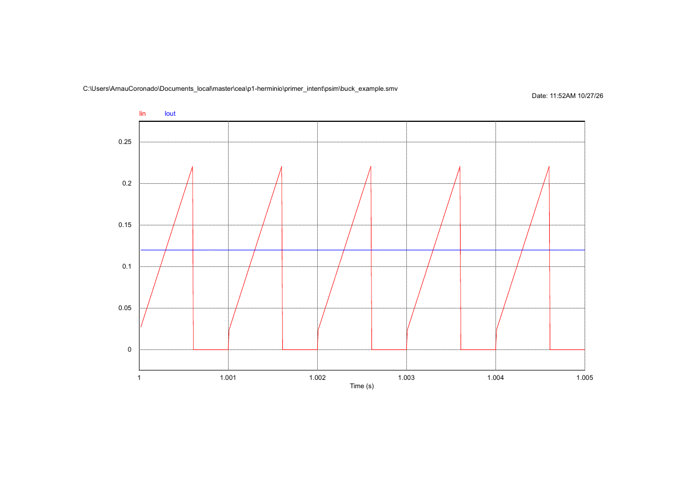
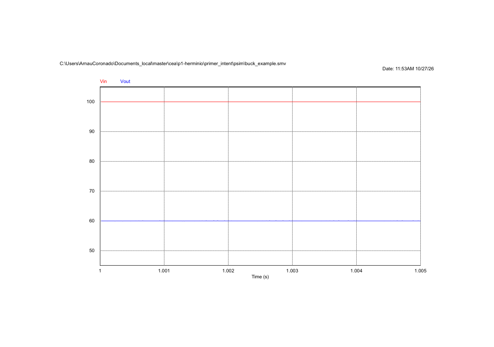
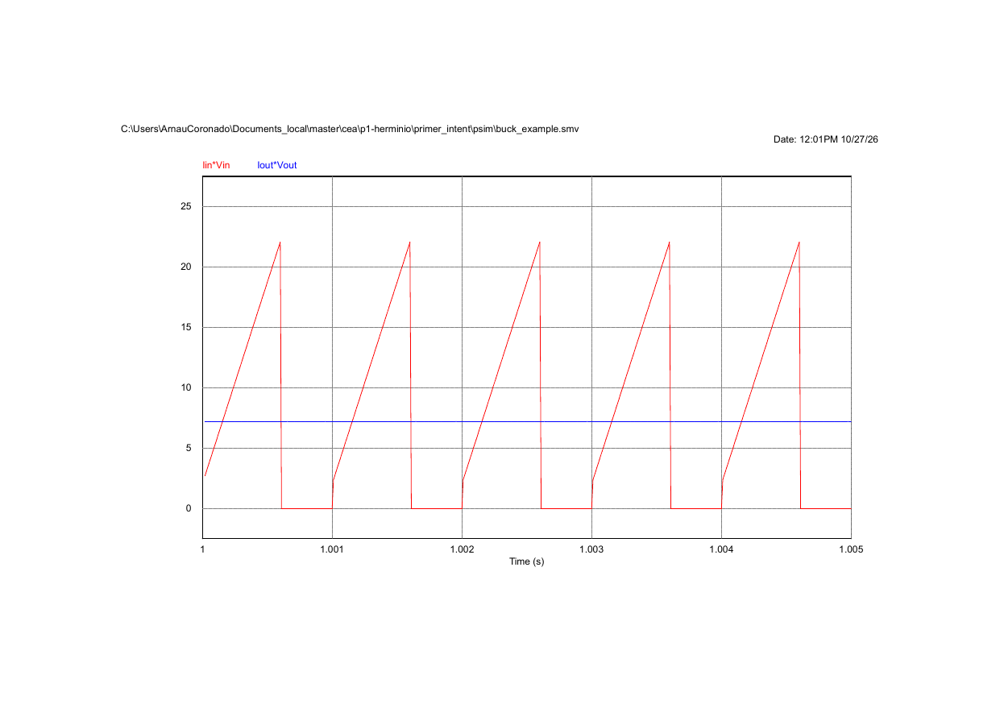
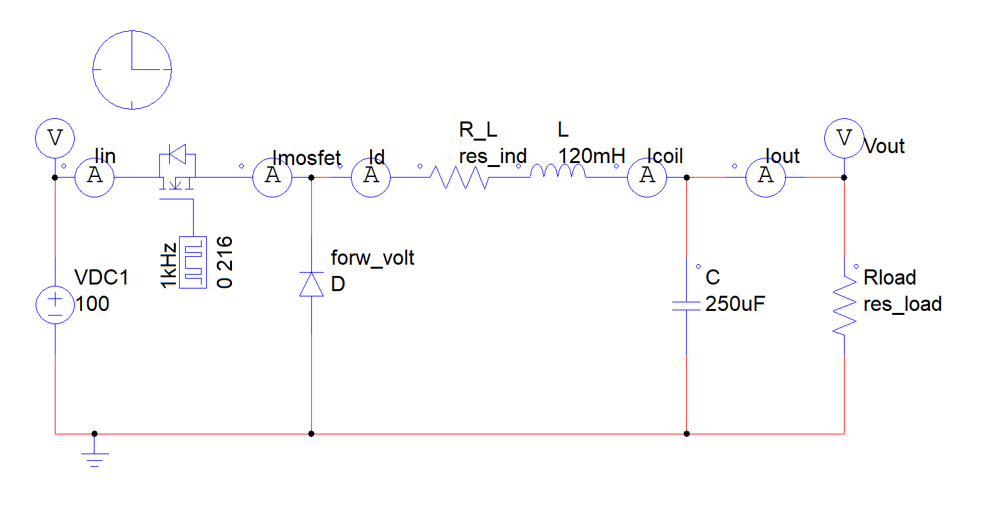
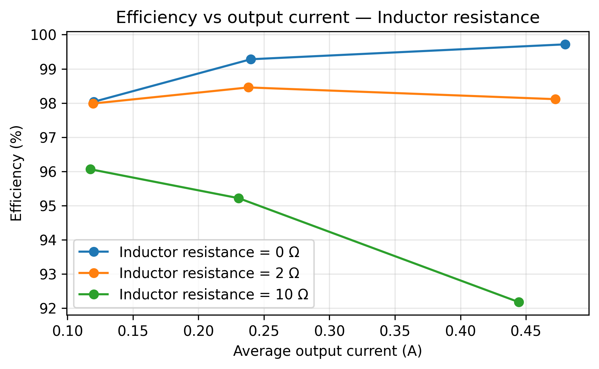
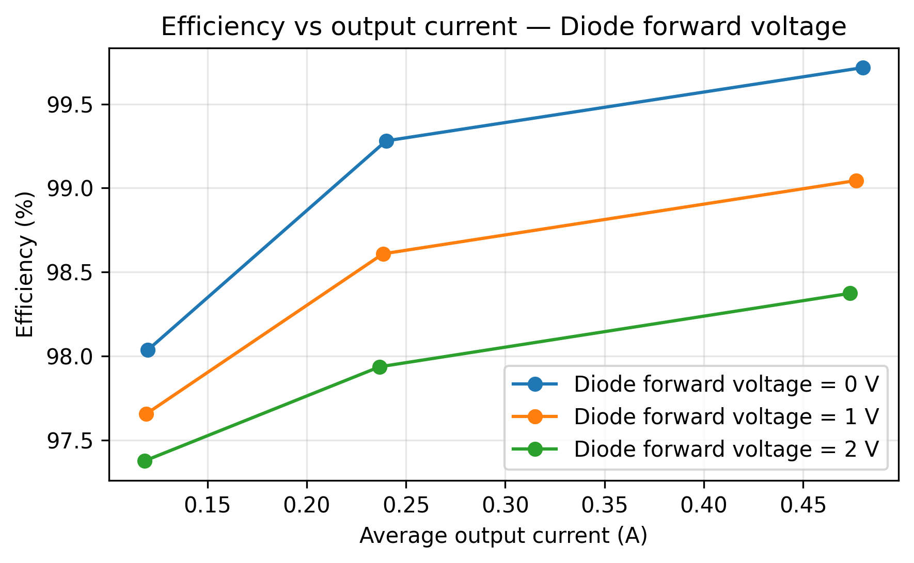
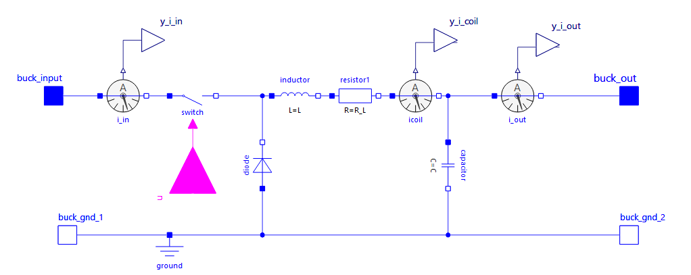
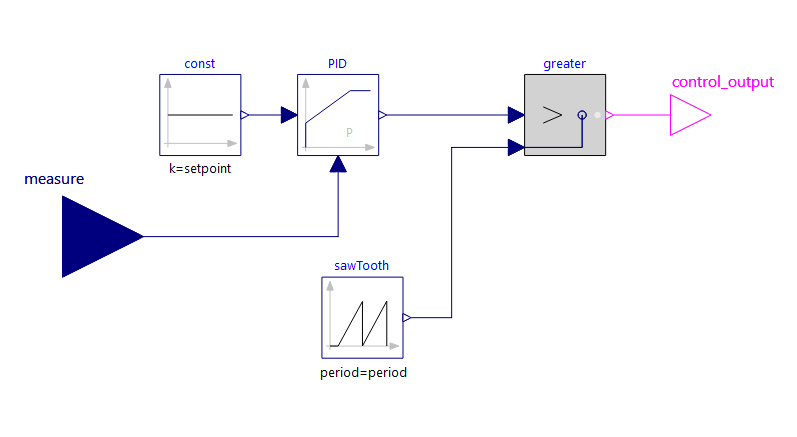
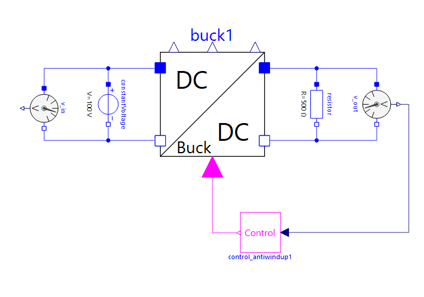

```{python}
import pandas 
import matplotlib.pyplot as plt
```

Course information

| | |
|---|---|
| Degree | Master's Degree in Technologies for Distributed Energy Systems (TSED) |
| Course | Advanced Electronic Conversion of Electrical Energy (CEAEE) |
| Course Code | 295SE013 |
| Department | Electronic Engineering (UPC) |
| Professors | Herminio Martínez-García and Robert Calatayud-Camps |
| Academic Year | 2025–2026 |

# Objectives

The objective of this laboratory session is to design and simulate several switched DC-DC converters using PSIM®, verify their theoretical behavior, evaluate component losses, and analyze closed-loop voltage regulation.

The converters studied are:

1. Buck converter
2. Buck converter with losses
3. Closed-loop buck converter
4. Boost converter
5. Buck-boost converter
6. Flyback converter
7. Forward converter

# Introduction

DC-DC converters are widely used in power supplies, renewable-energy systems, and electrical-energy processing applications.

Switching converters regulate voltage by controlling the duty cycle of semiconductor switches. They generally achieve higher efficiency than linear regulators.

For each converter, the theoretical design is performed first and then verified using PSIM® simulations.

# DEVELOPMENT OF THE LABORATORY SESSION

## Buck converter - Open loop

We will design a buck converter with the following specifications.

| Parameter | Value |
|---|---:|
| Input voltage | 100 V |
| Output voltage | 60 V |
| Maximum output current | 120 mA |
| Maximum output voltage ripple | 100 mV |
| Maximum inductor current ripple | 200 mA |
| Switching frequency | 1 kHz |


### Theoretical design

For an ideal buck converter.

$$
D = \frac{V_{out}}{V_{in}} = \frac{60}{100} = 0.6
$$

$$
T_{on} = DT_s = 0.6\ ms
$$

$$
T_{off} = (1-D)T_s = 0.4\ ms
$$

The load resistance is calculated as:

$$
R_{load} = \frac{V_{out}}{I_{out}} =
\frac{60}{0.12} = 500\ \Omega
$$

Minimum inductance and capacitance are calculated as follows:

$$
L =
\frac{(V_{in}-V_{out})D}
{\Delta I_L f_s}
=
\frac{(100-60)\cdot0.6}
{0.2 \cdot 1000}
=
0.12
=
120\ mH
$$

$$
C \geq
\frac{\Delta I_L}
{8f_s\Delta V_{out}}
= 
\frac{0.2}
{8 \cdot 1000 \cdot 0.1}
=
0.00025\ F
=
250\ \mu F
$$


| Parameter | Calculated |
|---|---:|
| Duty cycle | 0.60 |
| Switching period | 1 ms |
| Load resistance | 500 Ω |
| Inductance | 120 mH |
| Capacitance | 250 µF |
| Switching frequency | 1 kHz |

### PSIM simulation

In the first place a PSIM schematic of the buck converter is designed in the PSIM environment.

{#fig-buck-schematic width=80%}


### Simualtion results

The once the stationari state is reached, the output voltage and inductor current waveforms are shown in figures #fig-buck-current and #fig-buck-voltage.

| Simulation parameter | Value |
|---|---:|
| Time step | 10e-6 |
| Total simulation time | 1.005 |
| Print time | 1 |
| Print step | 1 |

```{python} 
#| label: buck-closed-loop-pi
#| fig-cap: "Buck converter current waveforms."
#| echo: false
#| output : true

import pandas as pd
import matplotlib.pyplot as plt
from pathlib import Path

csv_dir = Path("../psim/buck_openLoop/csv")
csv = csv_dir / "buck_openLoop.csv"

df = pd.read_csv(csv)

fig, (ax1, ax2, ax3) = plt.subplots(3, 1)
# fig.suptitle('title')
ax1.plot(df["Time"], df["Iin"], label="Input current")
ax1.plot(df["Time"], df["Iout"], label="Output current")
ax1.set_ylabel("Current (A)")


ax2.plot(df["Time"], df["Vin"], label="Input voltage")
ax2.set_ylabel("Input voltage (V)")

ax3.plot(df["Time"], df["Vout"])
ax3.set_xlabel('time (s)')
ax3.set_ylabel("Output voltage (V)")

plt.show()
```


{#fig-buck-current width=90%}

{#fig-buck-voltage width=90%}


### Efficiency of the circuit

The input and output powers are calculated from the simulated voltage and current measurements over the selected interval.

{#fig-buck-power width=90%}

$$
\begin{aligned}
\eta &= \frac{P_{out}}{P_{in}}\times100 \\
&= \frac{V_{out}I_{out}}{V_{in}I_{in}}\times100 \\
&= \frac{60 \times 0.12}{100 \times 0.072}\times100 \\
&= \frac{7.2}{7.2}\times100 \\
&= 100\%
\end{aligned}
$$

Because we are simulating an ideal converter, the efficiency is 100%.


## Buck converter with losses

In the first place a PSIM schematic of the buck converter is designed in the PSIM environment, but now the variables are left as parameters to be able to change them in the simulation.

{#fig-buck-losses-schematic width=90%}

This file can be exported to a Netlist File (Menu/Simulate/Generate Netlist File).

```{code-block}
.TIME 1E-005 1.005 1 1 0 0 0 0 0
.TI_DMC_VERSION 402 
VP Vin 1 
VP Vout 2 
VDC VDC1 1 0 100 0 0 
IP Icoil 3 4 
IP Iout 4 2 
C C 4 0 250uF 0 0 
L L 9 3 120mH 0 0 
DIODE D 0 8 forw_volt 0 0 0 
MOSFET Q1 5 6 7 0 1 0 0 0 
R Rload 2 0 res_load 0 
R R_L 10 9 res_ind 0 
IP Iin 1 5 
GATING G2 7 1kHz 2 0 216 
IP Imosfet 6 8 
IP Id 8 10 
```

The exported netlist can be simulated from the command line using PSIM's `PsimCmd.exe` tool, without manually opening the schematic in the graphical interface. This allows the simulation to be executed programmatically, with the resulting output variables exported to a text file for further analysis in Python.

### Inductor resistance

The following values are tested:

$$
R_{L} = 0\ \Omega,\quad
2\ \Omega,\quad
10\ \Omega
$$

The nominal load resistance is still $R_{\text{load}} = 500\, \Omega$.

```{python}
#| label: buck-simulation
#| echo: false
#| output: false
#| warning: false

from pathlib import Path
import subprocess
import pandas as pd

ROOT = Path.cwd().parent if Path.cwd().name == "report" else Path.cwd()
PSIM = Path(r"C:\Powersim\PSIM11.0.3_Demo\PsimCmd.exe")

SOURCE = ROOT / "psim" / "buck_losses.net"
NET = ROOT / "psim" / "buck_losses.net"
TXT = ROOT / "results" / "buck.txt"
CSV = ROOT / "results" / "buck.csv"
(ROOT / "results" / "txt").mkdir(parents=True, exist_ok=True)
(ROOT / "results" / "csv").mkdir(parents=True, exist_ok=True)

TXT.parent.mkdir(parents=True, exist_ok=True)

from itertools import product

RES_IND = [1e-10, 2, 10]
FORW_VOLT = 0
RES_LOAD = [500, 500/2, 500/4]

for res_ind, res_load in product(
    RES_IND, RES_LOAD
):
    params = {
        "voltage_in": "100",
        "res_load": str(res_load),
        "res_ind": str(res_ind),
        "forw_volt": str(FORW_VOLT),
    }

    # Create a separate netlist for each combination
    text = SOURCE.read_text()
    for name, value in params.items():
        text = text.replace(name, value)

    tag = f"RL{res_load:g}_RI{res_ind:g}_VF{0:g}"
    net_file = ROOT / "psim" / f"{tag}.net"
    txt_file = ROOT / "results" / "txt" / f"{tag}.txt"
    csv_file = ROOT / "results" / "csv" / f"{tag}.csv"

    net_file.write_text(text)

    print(f"Simulating: {tag}")

    subprocess.run([
        str(PSIM), "-c", str(net_file), "-o", str(txt_file)
    ], cwd=ROOT, check=True)

    df = pd.read_csv(txt_file, sep=r"\s+", engine="python")
    df.to_csv(csv_file, index=False)

    print(f"Saved: {csv_file}")
```


### Diode forward voltage

The following diode forward voltages are tested:

$$
V_F = 0\ V,\quad
1\ V,\quad
2\ V
$$


```{python}
#| label: buck-simulation_2
#| echo: false
#| output: false
#| warning: false

from pathlib import Path
import subprocess
import pandas as pd

ROOT = Path.cwd().parent if Path.cwd().name == "report" else Path.cwd()
PSIM = Path(r"C:\Powersim\PSIM11.0.3_Demo\PsimCmd.exe")

SOURCE = ROOT / "psim" / "buck_losses.net"
NET = ROOT / "psim" / "buck_losses.net"
TXT = ROOT / "results" / "buck.txt"
CSV = ROOT / "results" / "buck.csv"
(ROOT / "results" / "txt").mkdir(parents=True, exist_ok=True)
(ROOT / "results" / "csv").mkdir(parents=True, exist_ok=True)

TXT.parent.mkdir(parents=True, exist_ok=True)

from itertools import product

RES_IND = 1e-10
FORW_VOLT = [0, 1, 2]
RES_LOAD = [500, 500/2, 500/4]

for res_load, forw_volt in product(
    RES_LOAD, FORW_VOLT
):
    params = {
        "voltage_in": "100",
        "res_load": str(res_load),
        "res_ind": str(RES_IND),
        "forw_volt": str(forw_volt),
    }

    # Create a separate netlist for each combination
    text = SOURCE.read_text()
    for name, value in params.items():
        text = text.replace(name, value)

    tag = f"RL{res_load:g}_RI{0:g}_VF{forw_volt:g}"
    net_file = ROOT / "psim" / f"{tag}.net"
    txt_file = ROOT / "results" / "txt" / f"{tag}.txt"
    csv_file = ROOT / "results" / "csv" / f"{tag}.csv"

    net_file.write_text(text)

    print(f"Simulating: {tag}")

    subprocess.run([
        str(PSIM), "-c", str(net_file), "-o", str(txt_file)
    ], cwd=ROOT, check=True)

    df = pd.read_csv(txt_file, sep=r"\s+", engine="python")
    df.to_csv(csv_file, index=False)

    print(f"Saved: {csv_file}")
```


### Efficiency versus output current

Three output-current conditions are considered:

$$
R_{load} = 500\ \Omega,\quad
250\ \Omega,\quad
125\ \Omega
$$

### Results

```{python}
#| label: fig-efficiency-inductor
#| fig-cap: "Efficiency versus output current for different inductor resistances."
#| echo: false
#| output : false

from pathlib import Path
import re
import pandas as pd
import matplotlib.pyplot as plt

ROOT = Path.cwd().parent if Path.cwd().name == "report" else Path.cwd()
CSV_DIR = ROOT / "results" / "csv"
FIG_DIR = ROOT / "report" / "data" / "figures"
FIG_DIR.mkdir(parents=True, exist_ok=True)

LOADS = [500, 250, 125]
INDUCTOR_RESISTANCES = [0, 2, 10]
DIODE_VOLTAGES = [0, 1, 2]


def load_simulation(load, resistance, diode_voltage):
    """Load a PSIM simulation CSV and calculate steady-state efficiency."""
    tag = f"RL{load:g}_RI{resistance:g}_VF{diode_voltage:g}"
    path = CSV_DIR / f"{tag}.csv"

    if not path.exists():
        raise FileNotFoundError(f"Missing simulation data: {path}")

    df = pd.read_csv(path, sep=None, engine="python")
    df.columns = [
        re.sub(r"[^a-z0-9]", "", str(c).lower())
        for c in df.columns
    ]

    aliases = {
        "vout": ["vout", "outputvoltage"],
        "iout": ["iout", "outputcurrent"],
        "vin": ["vin", "inputvoltage"],
        "iin": ["iin", "inputcurrent"],
        "time": ["time", "t"],
    }

    columns = {}
    for key, candidates in aliases.items():
        columns[key] = next(
            (c for c in candidates if c in df.columns), None
        )

    missing = [
        key for key in ("vout", "iout", "vin", "iin")
        if columns[key] is None
    ]
    if missing:
        raise ValueError(
            f"{path.name}: cannot identify columns {missing}. "
            f"Available columns: {list(df.columns)}"
        )

    for key in ("vout", "iout", "vin", "iin"):
        df[key] = pd.to_numeric(df[columns[key]], errors="coerce")

    df = df.dropna(subset=["vout", "iout", "vin", "iin"])

    # Exclude the initial transient when a time column is available.
    if columns["time"] is not None:
        time = pd.to_numeric(df[columns["time"]], errors="coerce")
        df = df.loc[time >= time.max() - 0.005]

    if df.empty:
        raise ValueError(f"No valid steady-state data in {path.name}")

    pin = (df["vin"] * df["iin"]).mean()
    pout = (df["vout"] * df["iout"]).mean()

    if pin <= 0:
        raise ValueError(f"Invalid average input power in {path.name}")

    efficiency = 100 * pout / pin
    vout = df["vout"].mean()
    iout = df["iout"].mean()

    return iout, vout, pout, efficiency


def plot_efficiency(parameter_values, parameter_name, filename,
                    fixed_parameter):
    fig, ax = plt.subplots(figsize=(6, 3.75))

    for value in parameter_values:
        currents = []
        efficiencies = []

        for load in LOADS:
            if parameter_name == "Inductor resistance":
                resistance = value
                diode_voltage = fixed_parameter
            else:
                resistance = fixed_parameter
                diode_voltage = value

            iout, _, _, efficiency = load_simulation(
                load, resistance, diode_voltage
            )
            currents.append(iout)
            efficiencies.append(efficiency)

        order = sorted(range(len(currents)), key=currents.__getitem__)
        currents = [currents[i] for i in order]
        efficiencies = [efficiencies[i] for i in order]

        ax.plot(
            currents,
            efficiencies,
            marker="o",
            label=f"{parameter_name} = {value:g}"
            + (" Ω" if parameter_name == "Inductor resistance"
               else " V"),
        )

    ax.set_xlabel("Average output current (A)")
    ax.set_ylabel("Efficiency (%)")
    ax.set_title(f"Efficiency vs output current — {parameter_name}")
    ax.grid(True, alpha=0.3)
    ax.legend()
    fig.tight_layout()
    fig.savefig(FIG_DIR / filename, dpi=300, bbox_inches="tight")
    plt.show()
    plt.close(fig)


# Figure 4.1: V_F = 0 V, varying inductor resistance.
plot_efficiency(
    INDUCTOR_RESISTANCES,
    "Inductor resistance",
    "buck_efficiency_inductor_resistance.png",
    fixed_parameter=0,
)

# Figure 4.2: R_L(inductor) = 0 Ω, varying diode forward voltage.
plot_efficiency(
    DIODE_VOLTAGES,
    "Diode forward voltage",
    "buck_efficiency_diode_forward_voltage.png",
    fixed_parameter=0,
)
```


{width=75%}

{width=75%}


### Discussion

Increasing the inductor resistance increases conduction losses:

$$
P_L \approx I_L^2R_L
$$

Therefore, efficiency decreases as the inductor resistance increases, particularly at higher output currents. 

In the image it can be appreciated, however, that at ideal conditions and low resistance, the increase in the output current increases the efficiency. This is because the conduction losses are lower than the switching losses, which are constant and independent of the output current.

Increasing the diode forward voltage also increases conduction losses:

$$
P_D \approx V_F I_D
$$

Therefore, higher diode forward voltage produces lower efficiency.

Increasing the output current increases conduction losses in both the inductor and the diode, which reduces efficiency.

## Buck converter with losses — Closed loop

First the buck converter was designed in MODELICA.

{width=75%}


### P controller

The output voltage is regulated to $V_{\mathrm{ref}}=60\,\mathrm{V}$ from a $100\,\mathrm{V}$ input, giving $D=0.6$. A proportional controller $G_c(s)=K_P$ is used, with $K_P=0.01$.

{#fig-control-p width=75%}

The buck converter and the P controller are connected in a closed-loop configuration, as shown in the following figure.

{#fig-buck-closed-loop-p width=75%}

```{python} 
#| label: buck-closed-loop-p
#| fig-cap: "Buck converter response using P control."
#| echo: false
#| output : true

import pandas as pd
import matplotlib.pyplot as plt
from pathlib import Path

csv_dir = Path("../modelica/csv")
csv_sp40 = csv_dir / "buck_closedLoop_P_sp40.csv"
csv_sp60 = csv_dir / "buck_closedLoop_P_sp60.csv"
csv_sp80 = csv_dir / "buck_closedLoop_P_sp80.csv"

df_sp40 = pd.read_csv(csv_sp40)
df_sp60 = pd.read_csv(csv_sp60)
df_sp80 = pd.read_csv(csv_sp80)

plt.figure(figsize=(10, 5))
plt.plot(df_sp80["time"] * 1000, df_sp80["v_out.v"], label="Output voltage (SP = 80 V)")
plt.plot(df_sp60["time"] * 1000, df_sp60["v_out.v"], label="Output voltage (SP = 60 V)")
plt.plot(df_sp40["time"] * 1000, df_sp40["v_out.v"], label="Output voltage (SP = 40 V)")

plt.xlabel("Time (ms)")
plt.ylabel("Voltage (V)")
plt.title("Buck Converter Voltages with P Control")
plt.grid(True)
plt.legend()
plt.tight_layout()
plt.show()
```

| V_ref | V_out | Static error | Duty cycle |
|---:|---:|---:|---:|
| 80 V | 40 V | 40 V | 0.4 |
| 60 V | 30 V | 30 V | 0.3 |
| 40 V | 20 V | 20 V | 0.2 |

A P controller generally produces a non-zero static error because a finite error is required to generate the control action necessary to maintain the output voltage.

### PI controller

The controller is changed to:

$$
G_c(s)=K_P+\frac{K_I}{s}
$$

Controller parameters:

| Parameter | Value |
|---|---:|
| K_P | 0.01 |
| K_I | 0.05 |

The controller gains are adjusted to obtain a stable response with low overshoot and negligible steady-state error.

Results:

| V_ref | V_out | Static error |
|---:|---:|---:|
| 40 V | 40 V | 0 V |
| 60 V | 60 V | 0 V |
| 80 V | 80 V | 0 V |

```{python} 
#| label: buck-closed-loop-pi
#| fig-cap: "Buck converter response using PI control."
#| echo: false
#| output : true

import pandas as pd
import matplotlib.pyplot as plt
from pathlib import Path

csv_dir = Path("../modelica/csv")
csv_sp40 = csv_dir / "buck_closedLoop_PI_sp40.csv"
csv_sp60 = csv_dir / "buck_closedLoop_PI_sp60.csv"
csv_sp80 = csv_dir / "buck_closedLoop_PI_sp80.csv"

df_sp40 = pd.read_csv(csv_sp40)
df_sp60 = pd.read_csv(csv_sp60)
df_sp80 = pd.read_csv(csv_sp80)

plt.figure(figsize=(10, 5))
plt.plot(df_sp80["time"] * 1000, df_sp80["v_out.v"], label="Output voltage (SP = 80 V)")
plt.plot(df_sp60["time"] * 1000, df_sp60["v_out.v"], label="Output voltage (SP = 60 V)")
plt.plot(df_sp40["time"] * 1000, df_sp40["v_out.v"], label="Output voltage (SP = 40 V)")

plt.xlabel("Time (ms)")
plt.ylabel("Voltage (V)")
plt.title("Buck Converter Voltages with PI Control")
plt.grid(True)
plt.legend()
plt.tight_layout()
plt.show()
```

### Setpoint change

Apply a step change to the reference voltage.

| Parameter | Result |  
|---|---:|
| Initial reference | ______ V |
| Final reference | ______ V |
| Rise time | ______ |
| Settling time | ______ |
| Overshoot | ______ |
| Final steady-state error | ______ |

[INSERT SETPOINT RESPONSE HERE]

Figure 5.4 — Response to a change in voltage reference.

### Line regulation

Change the input voltage while keeping the output reference constant.

| Parameter | Result |
|---|---:|
| Initial input voltage | ______ V |
| Final input voltage | ______ V |
| Output voltage before change | ______ V |
| Output voltage after settling | ______ V |

[INSERT LINE REGULATION RESPONSE HERE]

Figure 5.5 — Line regulation of the closed-loop buck converter.

## Boost converter — Open loop

### Specifications

| Parameter | Value |
|---|---:|
| Input voltage | 100 V |
| Output voltage | 250 V |
| Maximum output current | 500 mA |
| Maximum output voltage ripple | 1 V |
| Maximum inductor current ripple | 500 mA |
| Switching frequency | 1 kHz |

### Theoretical design

Switching period:

$$
T_s=1\ ms
$$

For an ideal boost converter:

$$
D=1-\frac{V_{in}}{V_{out}}
=1-\frac{100}{250}
=0.6
$$

$$
T_{on}=0.6\ ms
$$

$$
T_{off}=0.4\ ms
$$

Load resistance:

$$
R_{load}=\frac{250}{0.5}=500\ \Omega
$$

Minimum inductance:

$$
L=
\frac{V_{in}D}
{\Delta I_Lf_s}
=
120\ mH
$$

Minimum capacitance:

$$
C\geq
\frac{I_{out}D}
{f_s\Delta V_{out}}
=
300\ \mu F
$$

Final design:

| Parameter | Calculated | Selected |
|---|---:|---:|
| Duty cycle | 0.60 | 0.60 |
| Switching period | 1 ms | 1 ms |
| Load resistance | 500 Ω | 500 Ω |
| Inductance | 120 mH | 120 mH |
| Capacitance | 300 µF | ______ |
| Switching frequency | 1 kHz | 1 kHz |

### Simulation and results

[INSERT BOOST PSIM SCHEMATIC HERE]

Figure 6.1 — Boost converter schematic.

| Quantity | Theoretical | Simulated |
|---|---:|---:|
| Average output voltage | 250 V | ______ |
| Maximum output voltage | — | ______ |
| Minimum output voltage | — | ______ |
| Output voltage ripple | ≤ 1 V | ______ |
| Maximum inductor current | — | ______ |
| Minimum inductor current | — | ______ |
| Inductor current ripple | ≤ 500 mA | ______ |

[INSERT OUTPUT VOLTAGE AND INDUCTOR CURRENT WAVEFORMS HERE]

Figure 6.2 — Boost converter steady-state waveforms.

## Buck-boost converter — Open loop

### Specifications

| Parameter | Value |
|---|---:|
| Input voltage | 100 V |
| Output voltage | -150 V |
| Maximum output current | 300 mA |
| Maximum output voltage ripple | 600 mV |
| Maximum inductor current ripple | 500 mA |
| Switching frequency | 1 kHz |

### Theoretical design

Switching period:

$$
T_s=1\ ms
$$

For an ideal inverting buck-boost converter:

$$
D=
\frac{|V_{out}|}
{V_{in}+|V_{out}|}
=
\frac{150}{100+150}
=
0.6
$$

Load resistance:

$$
R_{load}=
\frac{150}{0.3}
=
500\ \Omega
$$

Minimum inductance:

$$
L=
\frac{V_{in}D}
{\Delta I_Lf_s}
=
120\ mH
$$

Minimum capacitance:

$$
C\geq
\frac{I_{out}D}
{f_s\Delta V_{out}}
=
300\ \mu F
$$

Final design:

| Parameter | Calculated | Selected |
|---|---:|---:|
| Duty cycle | 0.60 | 0.60 |
| Switching period | 1 ms | 1 ms |
| Load resistance | 500 Ω | 500 Ω |
| Inductance | 120 mH | 120 mH |
| Capacitance | 300 µF | ______ |
| Switching frequency | 1 kHz | 1 kHz |

### Simulation and results

[INSERT BUCK-BOOST PSIM SCHEMATIC HERE]

Figure 7.1 — Buck-boost converter schematic.

| Quantity | Theoretical | Simulated |
|---|---:|---:|
| Average output voltage | -150 V | ______ |
| Maximum output voltage | — | ______ |
| Minimum output voltage | — | ______ |
| Output voltage ripple | ≤ 600 mV | ______ |
| Maximum inductor current | — | ______ |
| Minimum inductor current | — | ______ |
| Inductor current ripple | ≤ 500 mA | ______ |

[INSERT OUTPUT VOLTAGE AND INDUCTOR CURRENT WAVEFORMS HERE]

Figure 7.2 — Buck-boost converter steady-state waveforms.

## Flyback converter — Open loop

### Specifications

| Parameter | Value |
|---|---:|
| Input voltage | 12 V |
| Output voltage | 48 V |
| Maximum output current | 5 A |
| Maximum output voltage ripple | 10 mV |
| Transformer ratio N1/N2 | 100/200 |
| Magnetizing inductance | 100 µH |
| Switching frequency | 100 kHz |

### Theoretical design

Transformer ratio:

$$
\frac{N_1}{N_2}=0.5
$$

$$
\frac{N_2}{N_1}=2
$$

Switching period:

$$
T_s=10\ \mu s
$$

For an ideal flyback converter:

$$
V_{out}
=
\frac{N_2}{N_1}
\frac{D}{1-D}
V_{in}
$$

Therefore:

$$
D=
\frac{V_{out}}
{V_{out}+(N_2/N_1)V_{in}}
=
\frac{48}{48+2(12)}
=
0.667
$$

Load resistance:

$$
R_{load}=\frac{48}{5}=9.6\ \Omega
$$

Magnetizing inductance:

$$
L_m=100\ \mu H
$$

The output capacitance must be selected so that the simulated output ripple remains below 10 mV.

### Simulation and results

[INSERT FLYBACK PSIM SCHEMATIC HERE]

Figure 8.1 — Flyback converter schematic.

| Simulation parameter | Value |
|---|---:|
| Switching frequency | 100 kHz |
| Switching period | 10 µs |
| Time step | ______ |
| Total simulation time | ______ |
| Print time | ______ |
| Print step | 1 |

Results:

| Quantity | Specification | Simulated |
|---|---:|---:|
| Average output voltage | 48 V | ______ |
| Output voltage ripple | ≤ 10 mV | ______ |
| Maximum primary current | — | ______ |
| Output current | 5 A | ______ |

[INSERT OUTPUT VOLTAGE WAVEFORM HERE]

Figure 8.2 — Flyback converter output voltage.

[INSERT PRIMARY/MAGNETIZING CURRENT WAVEFORM HERE]

Figure 8.3 — Flyback converter magnetizing current.

[INSERT SWITCH WAVEFORM HERE]

Figure 8.4 — Flyback converter switch waveform.

## Forward converter — Open loop

### Specifications

| Parameter | Value |
|---|---:|
| Input voltage | 10 V |
| Output voltage | 48 V |
| Maximum output current | 10 A |
| Maximum output voltage ripple | 50 mV |
| Transformer ratio N1/N2 | 10/100 |
| Output inductance | 400 µH |
| Maximum inductor current ripple | 2 A |
| Switching frequency | 40 kHz |

### Theoretical design

Transformer ratio:

$$
\frac{N_1}{N_2}=0.1
$$

$$
\frac{N_2}{N_1}=10
$$

Switching period:

$$
T_s=25\ \mu s
$$

For an ideal forward converter:

$$
V_{out}
=
D
\frac{N_2}{N_1}
V_{in}
$$

Therefore:

$$
D=
\frac{48}{10(10)}
=
0.48
$$

Load resistance:

$$
R_{load}
=
\frac{48}{10}
=
4.8\ \Omega
$$

Given:

$$
L=400\ \mu H
$$

The secondary voltage during the ON interval is:

$$
V_{sec}
=
\frac{N_2}{N_1}V_{in}
=
100\ V
$$

The inductor voltage is:

$$
V_L=V_{sec}-V_{out}=52\ V
$$

Therefore:

$$
\Delta I_L=
\frac{V_LD}{Lf_s}
=
1.56\ A
$$

Since:

$$
1.56\ A < 2\ A
$$

the current-ripple specification is satisfied theoretically.

Minimum output capacitance:

$$
C\geq
\frac{\Delta I_L}
{8f_s\Delta V_{out}}
\approx97.5\ \mu F
$$

Final design:

| Parameter | Calculated | Selected |
|---|---:|---:|
| Duty cycle | 0.48 | 0.48 |
| Switching period | 25 µs | 25 µs |
| Load resistance | 4.8 Ω | 4.8 Ω |
| Inductance | 400 µH | 400 µH |
| Capacitance | ≥ 97.5 µF | ______ |
| Switching frequency | 40 kHz | 40 kHz |

### Simulation and results

[INSERT FORWARD PSIM SCHEMATIC HERE]

Figure 9.1 — Forward converter schematic.

| Simulation parameter | Value |
|---|---:|
| Switching frequency | 40 kHz |
| Switching period | 25 µs |
| Time step | ______ |
| Total simulation time | ______ |
| Print time | ______ |
| Print step | 1 |

Results:

| Quantity | Specification | Simulated |
|---|---:|---:|
| Average output voltage | 48 V | ______ |
| Maximum output voltage | — | ______ |
| Minimum output voltage | — | ______ |
| Output voltage ripple | ≤ 50 mV | ______ |
| Maximum inductor current | — | ______ |
| Minimum inductor current | — | ______ |
| Inductor current ripple | ≤ 2 A | ______ |

[INSERT OUTPUT VOLTAGE WAVEFORM HERE]

Figure 9.2 — Forward converter output voltage.

[INSERT INDUCTOR CURRENT WAVEFORM HERE]

Figure 9.3 — Forward converter inductor current.

[INSERT SWITCH AND TRANSFORMER WAVEFORMS HERE]

Figure 9.4 — Forward converter switching and transformer waveforms.

# Overall results

| Converter | V_in | V_out | D | L | C | f_s | Ripple | Result |
|---|---:|---:|---:|---:|---:|---:|---:|---|
| Buck | 100 V | 60 V | 0.60 | 120 mH | 250 µF | 1 kHz | ______ | ______ |
| Boost | 100 V | 250 V | 0.60 | 120 mH | ______ | 1 kHz | ______ | ______ |
| Buck-boost | 100 V | -150 V | 0.60 | 120 mH | ______ | 1 kHz | ______ | ______ |
| Flyback | 12 V | 48 V | 0.667 | 100 µH | ______ | 100 kHz | ______ | ______ |
| Forward | 10 V | 48 V | 0.48 | 400 µH | ______ | 40 kHz | ______ | ______ |

# Conclusions

## Buck converter

[WRITE CONCLUSION HERE]

## Non-ideal components

[WRITE CONCLUSION HERE]

## Open-loop versus closed-loop operation

[WRITE CONCLUSION HERE]

## P versus PI control

[WRITE CONCLUSION HERE]

## Boost converter

[WRITE CONCLUSION HERE]

## Buck-boost converter

[WRITE CONCLUSION HERE]

## Flyback converter

[WRITE CONCLUSION HERE]

## Forward converter

[WRITE CONCLUSION HERE]

## Overall conclusion

[WRITE FINAL CONCLUSION HERE]


# APPENDIX A — POWER AND EFFICIENCY CALCULATIONS

Input power:

$$
P_{in}=AVG(V_{in}I_{in})
$$

Output power:

$$
P_{out}=AVG(V_{out}I_{out})
$$

Efficiency:

$$
\eta=
\frac{P_{out}}{P_{in}}\times100
$$

The measurements must be performed during steady-state operation.

The averaging interval should contain an integer number of switching periods.

For the 1 kHz converters:

$$
T_s=1\ ms
$$

For example, a 10 ms averaging interval contains ten switching periods.

For the flyback converter:

$$
T_s=10\ \mu s
$$

For the forward converter:

$$
T_s=25\ \mu s
$$

